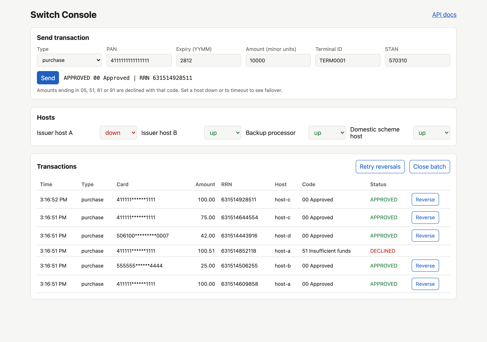

# qa-automation-framework

[](https://github.com/dobdaniel1/qa-automation-framework/actions/workflows/ci.yml)


API and UI test automation for a card payment switch, in Java with Karate and Playwright.

The system under test is [payment-switch-simulator](https://github.com/dobdaniel1/payment-switch-simulator): a switch that routes card transactions by BIN, fails over between hosts, reverses transactions, settles batches and reconciles them. The suites here check those behaviours the way a QA team would before a release.



## What is covered

| Area | Suite | Scenarios |
|---|---|---|
| Response contract | Karate | Every field, type and format of the transaction response, checked with a schema |
| Authorization | Karate | Approval, BIN routing, each decline code, expired card, Luhn failure, no route, input validation |
| Card data safety | Karate | The clear PAN never appears in any response |
| Idempotency | Karate | Repeated terminal and STAN returns the original result, never a second charge |
| Failover | Karate | Primary down, primary timeout with reversal, both hosts down, route with no fallback, unaffected routes |
| Reversals | Karate | Reverse, repeat safely, reject declined and unknown, store and forward while the host is down |
| Settlement | Karate | Batch totals exclude declined and reversed items, empty batch, no reversal after settlement |
| Reconciliation | Karate | Clean match, plus amount mismatch, missing on each side and duplicate host records |
| Console UI | Playwright | Approve, decline, failover via host controls, reverse then close batch |

39 API scenarios and 4 UI tests.

## Project layout

```
src/test/resources/
  karate-config.js          base URL, test data builders
  common/                   reusable features: reset, set host status, send, response schema
  switchapi/                authorization, failover, reversal, settlement features
src/test/java/
  switchapi/SwitchApiTest   JUnit 5 runner for the Karate suite
  ui/ConsolePage            page object for the switch console
  ui/ConsoleUiTest          Playwright tests
```

## Run locally

Start the switch:

```bash
git clone https://github.com/dobdaniel1/payment-switch-simulator
cd payment-switch-simulator && docker compose up -d --build --wait
```

Run the tests (Java 17+, Maven):

```bash
mvn test                      # everything
mvn test -Dgroups=api         # Karate only
mvn test -Dgroups=ui          # Playwright only
mvn test -Dswitch.url=http://other-host:8000
```

First UI run only: `mvn test-compile exec:java -Dexec.args="install chromium"`

Reports:

- Karate: `target/karate-reports/karate-summary.html`
- JUnit XML for CI dashboards: `target/surefire-reports`

## Design choices

- **Every scenario starts clean.** A reset call restores data and host statuses, so scenarios do not depend on order.
- **Karate runs single threaded on purpose.** Host status is shared state on the switch; parallel scenarios would change it under each other. Each CI job gets its own switch instead, so the API and UI suites run in parallel safely.
- **Unique STAN per request** from a generator in `karate-config.js`, so duplicate detection is only triggered when a test means to.
- **Expiry dates are computed**, two years ahead, so the suite does not start failing when a hard-coded date passes.
- **Schema checks, not field-by-field checks**, for the response contract, so a renamed or added field fails loudly.
- **Page object with test ids** for the UI, so styling changes do not break selectors.
- **Nightly CI run** against a fresh build of the switch, so a change there that breaks behaviour is caught within a day.

## License

MIT
